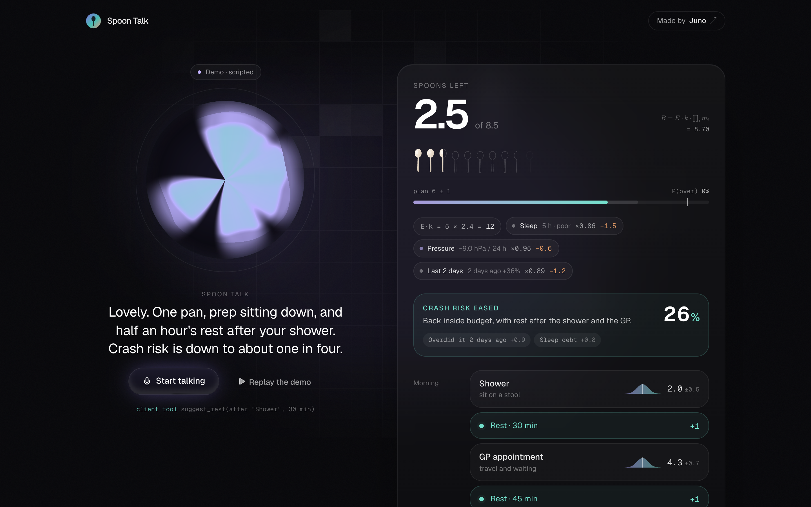
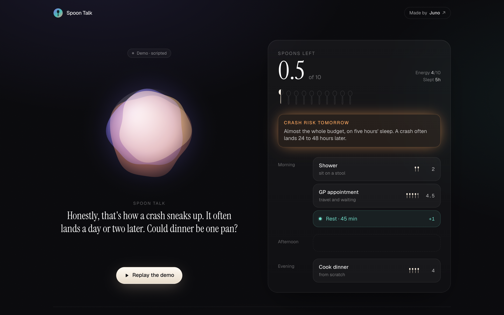
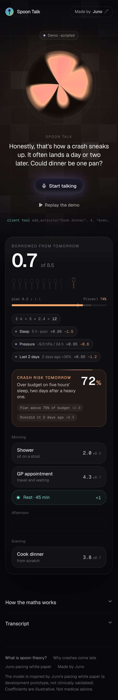
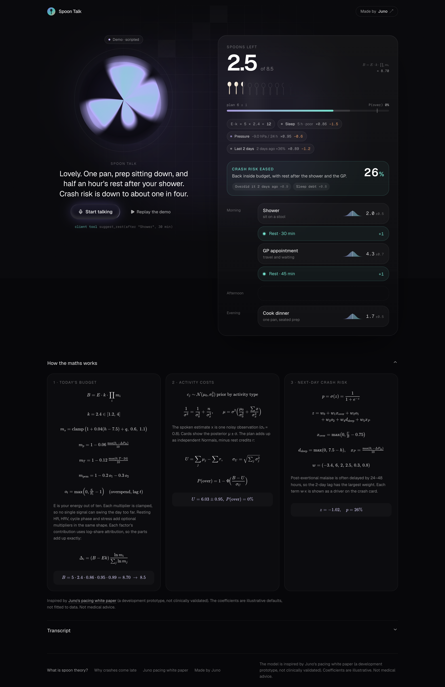

# Spoon Talk

**Plan your day in spoons. Just talk.** Spoon Talk is an open-source voice agent for people living with chronic illness. Tell it what today holds. It asks how you slept, how much energy you have and how the last two days went, and it checks the barometer. Then it builds a spoon budget, prices each task with an uncertainty band and warns you before a delayed crash. The screen updates live while it talks.

Built on [ElevenLabs Agents](https://elevenlabs.io/docs/eleven-agents/overview) with **client tools**, so the voice drives the UI. Made by [Juno](https://junocompanion.com), the companion app for people living with chronic illness.



> **Live demo:** [spoon-talk.vercel.app](https://spoon-talk.vercel.app)
>
> Works with no API keys: press **Watch the demo** for a scripted conversation that drives the exact same model and UI.

## What it does

You say: *"GP appointment at eleven, a shower, and I really want to cook tonight."*

1. It asks about your **energy**, **sleep** and **the last two days**, then reads **barometric pressure** from Open-Meteo.
2. It builds the day's **spoon budget** and shows each factor's effect, for example "Pressure −9 hPa / 24 h ×0.95 −0.6".
3. It prices each activity as a **Bayesian estimate** (prior for that type of activity, updated with the spoken estimate) and shows **μ ± σ**.
4. It adds **rest blocks**, which give spoons back.
5. It computes a **next-day crash risk** (logistic model) and names the main drivers. Post-exertional malaise is often delayed by [24 to 48 hours](https://junocompanion.com/blog/pacing-and-energy/delayed-post-exertional-malaise-how-to-spot-your-pem-window), so the last two days matter.
6. It offers one trade-off ("could dinner be one pan?") and re-prices the plan when you agree.

New to spoons? Read [What is spoon theory?](https://junocompanion.com/blog/pacing-and-energy/spoon-theory)

| Crash warning | Mobile | The maths |
| --- | --- | --- |
|  |  |  |

## The model

All the maths lives in [`src/lib/model.ts`](src/lib/model.ts): pure functions with unit tests in [`src/lib/model.test.ts`](src/lib/model.test.ts) (`npm test`). The app also renders it with KaTeX in a **How the maths works** section, filled in with your live numbers. Hover any factor, card or the crash percentage to see its own equation.

> It is **inspired by** Juno's technical white paper, [*Personalized pacing with Juno*](https://junocompanion.com/juno_pacing_whitepaper.pdf), which describes a **development prototype that is not clinically validated**. Every coefficient below is an **illustrative default** chosen to behave sensibly. None is fitted to data, and none comes from a study. Not medical advice.

### 1. Budget

$$B = E \cdot k \cdot \prod_i m_i, \qquad k = 2.4 \in [1.2,\ 4.0]$$

E is self-rated energy (0–10). Each multiplier is clamped, so no single signal can swing the day too far:

| Factor | Multiplier | Bounds |
| --- | --- | --- |
| Sleep (h hours, quality q: poor −0.04, ok 0, good +0.02) | $m_s = 1 + 0.04\,(h - 7.5) + q$ | [0.6, 1.1] |
| Barometric pressure, 24 h change (Open-Meteo) | $m_p = 1 - 0.06\,\max(0, -\Delta P_{24})/10$ | [0.85, 1] |
| Heat | $m_T = 1 - 0.12\,\max(0, T - 24)/10$ | [0.85, 1] |
| Last two days (PEM lag) | $m_{pem} = 1 - 0.2\,o_1 - 0.3\,o_2,\quad o_t = \max(0, S_t/B_t - 1)$ | [0.6, 1] |
| Resting HR vs baseline | $m_{hr} = 1 - 0.012\,\max(0, \Delta RHR)$ | [0.85, 1] |
| HRV vs baseline | $m_{hrv} = 1 - 0.003\,\max(0, -\Delta HRV\%)$ | [0.85, 1] |
| Cycle phase | menstrual 0.93, luteal 0.97, otherwise 1 | |
| Stress (0–10) | $m_\sigma = 1 - 0.025\,\max(0, s - 5)$ | [0.85, 1] |

Each factor's effect in spoons uses **log-share attribution**. It doesn't depend on factor order, and the parts add up exactly to the total change:

$$\Delta_i = (B - E k)\,\frac{\ln m_i}{\sum_j \ln m_j}$$

Rapid pressure drops are commonly *reported* to worsen pain and fatigue, and only falls count. The 2-day lag weighs more than yesterday because delayed PEM often lands 24–48 h after the exertion.

### 2. Activity costs (conjugate Normal update)

Each activity type has a prior $c \sim \mathcal N(\mu_0, \sigma_0^2)$, for example appointment N(4, 1.2²) or simple meal N(1.5, 0.6²). The agent's spoken estimate x is one noisy observation with $\sigma_x = 0.8$:

$$\frac{1}{\sigma^2} = \frac{1}{\sigma_0^2} + \frac{n}{\sigma_x^2}, \qquad \mu = \sigma^2\left(\frac{\mu_0}{\sigma_0^2} + \frac{\sum x}{\sigma_x^2}\right)$$

The plan adds up as independent Normals, minus rest credits r (30+ min gives 1 spoon, shorter rests ½):

$$U = \sum_j \mu_j - \sum r, \qquad \sigma_U = \sqrt{\textstyle\sum_j \sigma_j^2}, \qquad P(\text{over}) = 1 - \Phi\!\left(\frac{B - U}{\sigma_U}\right)$$

### 3. Next-day crash risk (logistic)

$$p = \sigma\big(w_0 + w_1 x_{over} + w_2 o_1 + w_3 o_2 + w_4 d_{sleep} + w_5 x_P\big)$$

where $x_{over} = \max(0, U/B - 0.75)$, $d_{sleep} = \max(0, 7.5 - h)$, $x_P = \max(0, -\Delta P_{24})/10$ and $w = (-3.4,\ 6,\ 2,\ 2.5,\ 0.3,\ 0.8)$. Each term $w_i x_i$ is shown as a driver on the crash card: below 35% is low, 35–60% moderate, above 60% high.

### The demo, in numbers

| Step | Budget | Plan | Crash risk |
| --- | --- | --- | --- |
| Energy 5, 5 h poor sleep, heavy day 2 days ago (15 of 11), pressure −9 hPa | 5·2.4·0.86·0.95·0.89 = **8.70 → 8.5** | | |
| Shower, GP (4.5 → 4.3 ± 0.7), rest, cook from scratch (4 → 3.8 ± 0.7) | 8.5 | 9.2 ± 1.1, P(over) 74% | **72% high** |
| One-pan dinner (2 → 1.7 ± 0.5) + 30 min rest after the shower | 8.5 | 6.0 ± 1.0, 2.5 left | **26% low** |

## How it uses ElevenLabs

| Piece | ElevenLabs feature |
| --- | --- |
| The conversation | An **ElevenLabs Agent**: speech recognition, LLM, turn-taking, interruptions |
| The voice | **ElevenLabs TTS** (`eleven_flash_v2`, "Sarah" by default) |
| The live UI | **Client tools**: the agent calls functions that run in the browser and return live readouts |
| Context | `sendContextualUpdate` passes the agent the local weather from Open-Meteo |
| Connection | `@elevenlabs/react` `useConversation` over **WebRTC**, with a short-lived conversation token |
| Key safety | A **private agent** (auth on). `/api/conversation-token` mints tokens server-side, and `ELEVENLABS_API_KEY` never reaches the browser |
| UI | **[ElevenLabs UI](https://ui.elevenlabs.io)**: Orb (WebGL), Live Waveform, Shimmering Text, Conversation and Message |

### Client tools

Defined once in [`src/lib/agent.ts`](src/lib/agent.ts), registered with the agent by `scripts/create-agent.ts` and handled in the browser with `useConversationClientTool`:

| Tool | Feeds |
| --- | --- |
| `set_energy(level)` | E |
| `set_sleep(hours, quality)` | $m_s$, sleep debt |
| `log_previous_day(days_ago, spent, budget)` | $o_1, o_2$ (PEM lag) |
| `set_body_signals(resting_hr_delta?, hrv_delta_pct?, cycle_phase?, stress?)` | optional multipliers |
| `add_activity(name, spoons, when, note?)` | Bayesian cost (calling it again with the same name re-costs) |
| `remove_activity(name)` | plan |
| `suggest_rest(after, minutes)` | rest credits |
| `flag_crash_risk(reason)` | the sentence on the crash card (the % is computed) |

Every tool returns the model readout as text, so the agent says real numbers and gives real reasons:

```
Budget 8.5 spoons = energy 5 x k 2.4 x sleep x0.86 (5 h · poor, -1.5 spoons), pressure x0.95 (−9.0 hPa / 24 h, -0.6 spoons),
last 2 days x0.89 (2 days ago +36%, -1.2 spoons). … Plan uses 9.2 +/- 1.1 spoons, 0.7 OVER; P(over budget) 74%.
Next-day crash risk 72% (high), driven by plan above 75% of budget and overdid it 2 days ago.
```

So the agent can say: *"pressure's dropped 9 hPa since yesterday, so I've trimmed your budget a little."*

## Built with

- **[ElevenLabs UI](https://ui.elevenlabs.io)** (shadcn registry): `orb`, `live-waveform`, `shimmering-text`, `conversation`, `message`
- **[shadcn/ui](https://ui.shadcn.com)**: button, hover-card, accordion, separator, avatar
- **[Magic UI](https://magicui.design)**: number-ticker, border-beam, shimmer-button, animated-grid-pattern
- **[Motion](https://motion.dev)**: layout animations (the hero becomes a split view), spring card reveals
- **[KaTeX](https://katex.org)**: equations; **[Open-Meteo](https://open-meteo.com)**: pressure and temperature (free, no key)
- Next.js App Router, TypeScript, Tailwind CSS v4, Geist Sans and Mono, Vitest

The registry components in `src/components/ui/` are kept as installed (and excluded from lint) so they can be re-pulled:

```bash
npx shadcn@4.21.1 add https://ui.elevenlabs.io/r/orb.json https://ui.elevenlabs.io/r/live-waveform.json \
  https://ui.elevenlabs.io/r/shimmering-text.json https://ui.elevenlabs.io/r/conversation.json https://ui.elevenlabs.io/r/message.json \
  https://magicui.design/r/number-ticker.json https://magicui.design/r/border-beam.json \
  https://magicui.design/r/shimmer-button.json https://magicui.design/r/animated-grid-pattern.json
```

## Setup

Requires Node 20.6+.

```bash
git clone https://github.com/MarshallBear1/spoon-talk.git && cd spoon-talk
npm install
npm run dev     # http://localhost:3000: demo mode works straight away
npm test        # model unit tests
```

### Turn on the live voice agent

1. Get an API key at [elevenlabs.io](https://elevenlabs.io/app/settings/api-keys) with Agents permissions.
2. Create the agent (8 client tools, system prompt, first message, voice):

   ```bash
   cp .env.example .env.local        # add ELEVENLABS_API_KEY
   npm run create-agent              # prints ELEVENLABS_AGENT_ID=agent_...
   npm run create-agent -- --dry-run # or just print the payload
   ```

3. Add `ELEVENLABS_AGENT_ID` to `.env.local` and restart. **Start talking** asks for your location (falling back to London) for the weather, then asks for the mic.

| Env var | Required | Notes |
| --- | --- | --- |
| `ELEVENLABS_API_KEY` | for live mode | Server only |
| `ELEVENLABS_AGENT_ID` | for live mode | From `npm run create-agent` |
| `ELEVENLABS_VOICE_ID` | no | Default `EXAVITQu4vr4xnSDxMaL` ("Sarah") |
| `ELEVENLABS_LLM` | no | Default `gemini-2.5-flash` |
| `NEXT_PUBLIC_SITE_URL` | no | Absolute URL for Open Graph tags |

Without the first two, the page runs in demo mode. `/api/conversation-token` limits each IP to 6 sessions a minute.

Demo URL flags: `/?demo=play` autoplays (add `&speed=2` for faster), `/?demo=crash` and `/?demo=end` freeze a frame, and `&maths=open` expands the maths section. `npm run screenshots` regenerates `docs/` and `public/og.png` (Playwright with your installed Chrome).

## Not medical advice

Spoon Talk is a planning aid, not a medical device. The model is a rough, illustrative guide: it doesn't diagnose, treat or replace your clinician. If something feels new, severe or worrying, contact your doctor or emergency services.

## Credits

Built by **[Juno](https://junocompanion.com)**, a companion app for people living with chronic illness. Voice and conversation by [ElevenLabs](https://elevenlabs.io). Spoon theory was created by Christine Miserandino. Weather by [Open-Meteo](https://open-meteo.com).

MIT licensed. See [LICENSE](LICENSE).
